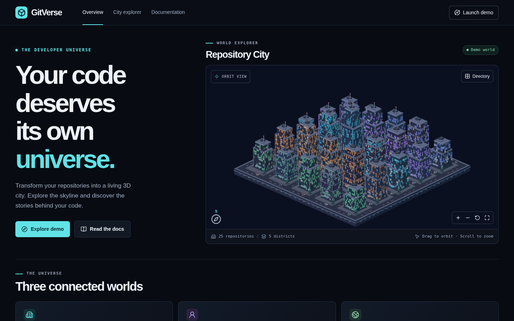

# GitVerse

Your code. Your city. Your universe.

Explore a procedural 3D city of 25 fictional repositories across five language districts. Select a building or find a project in the directory to inspect its metadata. The Phase 1 demonstration runs locally without a GitHub account.

## Run locally

Use Node.js 24 and npm. From this directory run:

```sh
npm ci
npm run dev
```

Open the local URL printed by Next.js, usually http://localhost:3000. Visit / for the landing page, /demo/ for the explorer and /docs/ for the field guide. Drag to orbit and scroll or pinch to zoom. The directory supports text search and keyboard navigation. Escape closes panels.

## Validate and build

```sh
npm run typecheck
npm run lint
npm test
npm run build
```

The production export lives in out/. Serve that directory with a local HTTP server, for example `python3 -m http.server 3000 --directory out`. No runtime secrets or environment variables are required. Package installation requires access to the npm registry.

## Project guide

The App Router entry points compose a React interface and browser-side Three.js scene. Shared fixture IDs connect the scene and inspector. Geometry and local fixtures ship with the application.

- [Product research and acceptance criteria](docs/PRODUCT_SPEC.md)
- [Architecture and compatibility](docs/ARCHITECTURE.md)
- [City generation](docs/CITY_ENGINE.md)
- [Verification guidance](docs/TESTING.md)
- [Development progress](docs/DEVELOPMENT_PROGRESS.md)
- [Public roadmap](docs/ROADMAP.md)
- [Contributing](CONTRIBUTING.md), [community conduct](CODE_OF_CONDUCT.md) and [security reporting](SECURITY.md)
- [Asset attribution](docs/ASSETS.md) and [MIT license](LICENSE)

Vehicle exploration, live GitHub synchronization and multiplayer are later milestones. A graphics-capable browser provides the 3D experience; the repository directory provides a conventional path to sample data.

## Offline edition

Open GitVerse.html from the delivery in a WebGL2-capable browser. The file contains the application, renderer, icons and fixtures. To rebuild it from source run `npm run portable`. To run the packaged-browser checks, use `CHROMIUM_PATH=/path/to/chromium node scripts/check-portable.mjs` after that build.


